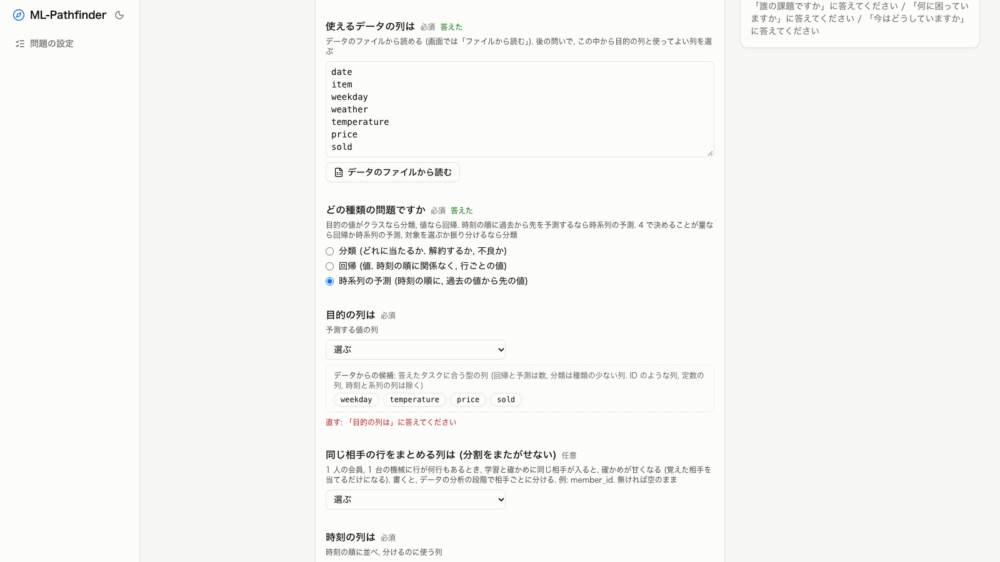
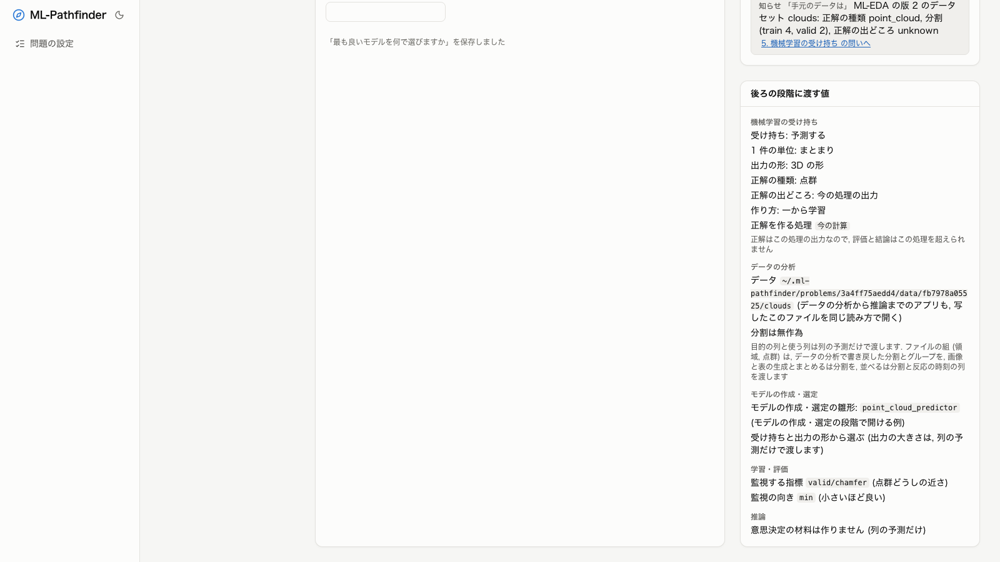

# ML-Pathfinder

機械学習に向けた問題を設計するローカルの Web アプリ. 「機械学習を全て GUI 上で行う」うちの最初の段階 (問題の設定) の画面で, ライブラリの [ML-Quest](https://github.com/victor-von-pooh/ML-Quest) を動かす.

課題から始めて決まった順の問いに答え, どの部分を機械学習に任せると課題が解けるかを決める. 機械学習が要らないと分かれば, そこで終える.


<table>
  <tr>
    <td></td>
    <td></td>
  </tr>
  <tr>
    <td></td>
    <td></td>
  </tr>
  <tr>
    <td></td>
    <td></td>
  </tr>
</table>

画面の例は, アプリの見本 (架空の課題で答えを埋めた「総菜の作る量」と「解約の引き止め」) と, 画面で答えた架空の問題 (撮影から形の点群を作る, 売れる数の予測). 入れたデータは, 総菜の見本と同じ列の作り物の表と, ML-EDA の合成の撮影と点群から書き出した小さなデータセット. 置き場のパスは既定の `~/.ml-pathfinder` で, 書き出し先はホームの下で示している.

## できること

- **問いに答える**: 課題, 解けたと言える指標, 課題の分解, 決めること, 機械学習の受け持ち, 予測の時点で使える情報, 損得と制約, 学習で見る指標, 効果の確かめ方, 運用の 10 の節. 今の答えで要らない問いは出ない
- **確かめと筋道**: 答えるたびに, 答えどうしの食い違いと足りない答え (直す, 見直す, 知らせ) と, 課題から行動までの筋道が出る
- **手元のデータ**: 表のファイルか ML-EDA のデータセットを入れると, 列の名前と答えの候補 (目的の列, 時刻の列, 漏れの疑いのある列など) と, データの確かめが出る
- **後ろの段階に渡す値**: データの分析 (ML-Fathom), モデルの作成 (ML-CreateArchitecture), 学習 (ML-Found, ML-Dashboard), 推論 (ML-Provide) で選ぶ値を見る. 列の予測のほか, 画像の領域や点群などの受け持ちも渡せる
- **学習のプロジェクトの書き出し**: 直すところが無くなると, ML-Found のプロジェクトの骨組み (config と学習のスクリプト) を書き出せる. 書き出した場所 (データセットとモデルの定義の置き場も) は問題の設定に記録し, 後ろの段階のアプリが写さずに使う
- **見本と取り込み**: 架空の課題の見本 3 つ (機械学習を使わないで終える例も) と, 書き出した `problem.yaml` の取り込みと保存
- ライトとダークの表示

## 使い方

### 必要なもの

- [uv](https://docs.astral.sh/uv/) (Python は uv が用意する. 3.10 以上)
- Node.js 24 以上と [pnpm](https://pnpm.io/) 11 以上 (`corepack enable` で `package.json` の版が入る)

### 導入と起動

```bash
git clone --recursive https://github.com/victor-von-pooh/ML-Pathfinder.git
cd ML-Pathfinder
make setup   # submodule, Python と Node.js の依存
make serve   # 画面をビルドして http://127.0.0.1:8770 で起動 (使う間は端末を開いたままにする. Ctrl+C で止める)
```

起動すると `ML-Pathfinder を開く: http://127.0.0.1:8770/api/auth?token=...` の行が出るので, その URL をブラウザで開く (トークンは起動ごとに変わる). 毎回同じトークンにする場合は環境変数 `ML_PATHFINDER_TOKEN` で指定する. ポートは `make serve PORT=8800` のように変えられる.

試すだけなら, 一覧の「見本を開く」で見本の写しを開く. 問題の設定の置き場は `~/.ml-pathfinder/` (環境変数 `ML_PATHFINDER_HOME` で変えられる).

## 文書

- [操作ガイド](docs/GUIDE.md): 画面の順の操作ガイド (問いの答え方, データの入れ方, 書き出しの後にすること). 最後の章が「困ったとき」
- [設計](docs/DESIGN.md): 今の設計と決まり (ML-Quest との約束, 画面, API, 用語, 置き場, 安全)
- [TODO](TODO.md): まだやっていないこと (優先度の順)

## 開発

```bash
make dev-backend    # API (変更を自動で読み直す. 開く URL を出す)
make dev-frontend   # 画面 (別の端末で)
make check          # lint, 型検査, テスト
cd frontend && pnpm e2e   # 画面の通しのテスト
```

| ディレクトリ | 内容 |
| --- | --- |
| `backend/` | API (Python, FastAPI). ML-Quest を呼び, 問題の設定を保存する |
| `frontend/` | 画面 (TypeScript, React, Vite) |
| `ML-Quest/` | submodule (問題の設定のライブラリ) |
| `docs/` | 操作ガイド, 設計, README の画面の例 (`images/`) |

## ライセンス

MIT
